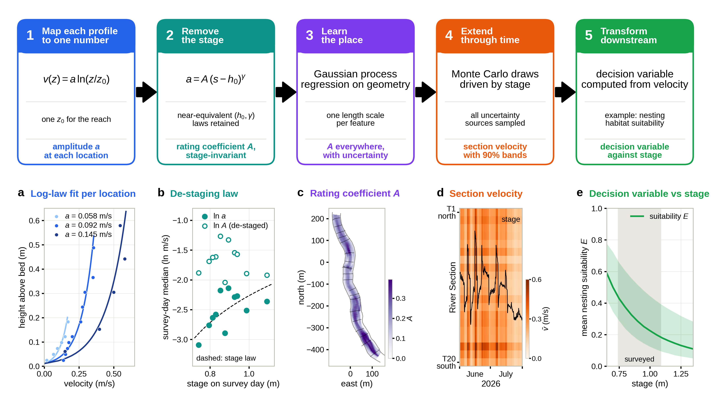

# physicsBasedRiverML

A physics-informed machine-learning soft sensor for river velocity. A continuous water level record and a few days of
field velocity surveys give velocity across a whole river reach, every 2 hours, with calibrated uncertainty. A
velocity-dependent decision variable is then computed downstream of the model; here it is smallmouth bass nesting
suitability.

This repository holds all the code and data behind the paper's results. One command reruns the analysis from the
raw data and regenerates the paper's six figures, the supplementary log-law profiles and every number quoted in the
text.

> [Authors] (in review). *Journal of Hydroinformatics*, special issue on AI/ML and data-driven methods
> for human-impacted water systems. [citation and DOI to be added]



## The method in five steps

| step | what it does | equation | script |
|---|---|---|---|
| 1. Map each profile to one number | Fits every velocity profile with the log law, using one roughness length for the reach. Each location then has one amplitude. | v(z) = a ln(z / z0) | `pipeline/s04_step1_log_law.py` |
| 2. Remove the stage | Divides out the survey-day stage with a law chosen by holding out whole survey days. What remains is a stage-invariant rating coefficient A. | a = A (s − h0)^γ | `pipeline/s06_step2_stage_law.py` |
| 3. Learn the place | Gaussian process regression of ln A on six channel-geometry features, with Matérn 3/2 ARD and fixed per-point noise. Validated with whole sections and whole days held out. | ln A ~ GP | `pipeline/s07_step3_gaussian_process.py` |
| 4. Extend through time | The stage record drives Monte Carlo draws that sample every source of uncertainty: the GP field, model discrepancy, bed, stage, stage law and z0. | v̄ = a [ln(h / z0) − 1] | `pipeline/s08_step4_monte_carlo.py` |
| 5. Transform downstream | Converts velocity into a decision variable. Here it is mean nesting suitability, learned from nest locations with a used–available logistic model. | S(v) = exp(b_v v) | `pipeline/s09_step5_nest_suitability.py` |

Steps 1–4 apply anywhere a continuous water level record and velocity profiles with bed elevation exist. Step 5 is the
only application-specific step.

## Run it

Python 3.11:

```bash
python -m venv .venv
source .venv/bin/activate          # Windows: .venv\Scripts\activate
pip install -r requirements.txt
python run_all.py                  # about 10 minutes
```

After one full run, `python run_all.py --figures` redraws the figures from the intermediate outputs, which takes
about a minute.
Each script also runs on its own once the outputs of the scripts before it exist. The header of every script lists its
inputs and outputs.

All random seeds are fixed. With the pinned package versions, a rerun from a fresh clone reproduces every number in
the paper and regenerates its figures.

## Repository layout

```
data/                         the only external inputs (see below)
riverml/                      shared code
  config.py                     paths and every study setting (thresholds, grids, seeds)
  geometry.py                   main-stem centerline, reach coordinates, bank lines and channel polygon
  gp.py                         the Gaussian process, the stage-law target, CRPS and other scores
  chain.py                      the Monte Carlo chain (step 4)
pipeline/                     the analysis, in run order
  s01_stage_record.py           data: stage record cleaned; ADCP record on the same 10 min grid
  s02_field_survey.py           data: velocity readings and nests, each with the stage at its time
  s03_channel_geometry.py       data: centerline, bank lines, channel polygon
  s04_step1_log_law.py          step 1: z0, amplitude a per location, RTK bed on the stage datum
  s05_geometry_features.py      inputs for step 3: geometry features of each location
  s06_step2_stage_law.py        step 2: stage law by day-held-out cross-validation; ADCP check
  s07_step3_gaussian_process.py step 3: cross-validation, hyperparameters (Table 1), map of A
  s08_step4_monte_carlo.py      step 4: section velocities every 2 h; held-out-day validation; uncertainty attribution
  s09_step5_nest_suitability.py step 5: nest model; suitability E against stage and through time
  s10_paper_numbers.py          collects every number quoted in the paper
figures/                      one script per figure
outputs/
  figures/                      fig1-fig6 and figS1-figS6 (PNG and PDF)
  results/                      table1_hyperparameters.csv, table2_cross_validation.csv, paper_numbers.md
  intermediate/                 tables passed between steps (regenerated, not tracked)
run_all.py
```

## Data

| file | contents |
|---|---|
| `25_ecohydroData.csv`, `26_ecohydroData.csv` | Field surveys from 2025 and 2026. Each row is one reading: velocity (ft/s) at a height above the bed (`Depth`, ft), with total water depth, RTK coordinates and elevation (NAD83 StatePlane Michigan South, US ft), transect and point IDs, and field notes. Rows of type `Nest` are smallmouth bass nests. In 2025, `Reading Division` is the fraction of the depth at which the reading was taken. |
| `25_depthSensorData_Middle.csv`, `26_depthSensorData_Middle.csv` | Bridge-mounted ultrasonic sensor upstream of the reach: range to the water surface (mm) every 10 min. Stage = 7313.2 mm mounting offset − range. |
| `25_ADCPData.csv` | Bed-mounted, upward-facing ADCP in the reach, 2025: velocity (m/s). Used only as an independent check. |
| `Huron_RiverSystem.geojson` | Huron River flowlines (National Hydrography Dataset). The main-stem centerline is extracted from these. |
| `basemap/` | Used only for Figure 2a: an ArcGIS export of the watershed and its georeference. Basemap: Esri, NASA, NGA, USGS, TomTom, Garmin, FAO, NOAA, OpenStreetMap contributors, GIS User Community. |

The study reach is the set of survey rows with northing between 280,000 and 323,000 ft. Crew names were removed from
the survey sheets; nothing else was changed.

## Figures and tables

| paper | file | script |
|---|---|---|
| Figure 1. The five-step method | `outputs/figures/fig1_method.png` | `figures/fig1_method.py` |
| Figure 2. Study area and data | `outputs/figures/fig2_study_area.png` | `figures/fig2_study_area.py` |
| Figure 3. Steps 1 and 2 | `outputs/figures/fig3_steps1_2.png` | `figures/fig3_steps1_2.py` |
| Figure 4. Step 3 | `outputs/figures/fig4_step3.png` | `figures/fig4_step3.py` |
| Figure 5. Step 4 | `outputs/figures/fig5_step4.png` | `figures/fig5_step4.py` |
| Figure 6. Step 5 | `outputs/figures/fig6_step5.png` | `figures/fig6_step5.py` |
| Figures S1–S6. Log-law fit at every location | `outputs/figures/figS1-S6_log_law_profiles.png` | `figures/figS_log_law_profiles.py` |
| Table 1. GP hyperparameters and stage law | `outputs/results/table1_hyperparameters.csv` | `pipeline/s07_step3_gaussian_process.py` |
| Table 2. Cross-validation | `outputs/results/table2_cross_validation.csv` | `pipeline/s10_paper_numbers.py` |
| Every other number in the text | `outputs/results/paper_numbers.md` | `pipeline/s10_paper_numbers.py` |

## Notes

- **Bank lines.** The edges of the wetted channel are placed from the bank points noted in the field. Where no bank
  was surveyed, the outermost survey points plus a measured margin are used (`riverml/geometry.py`). The survey points
  passed to that routine are the set used when the published bank lines were first drawn
  (`legacy_edge_points` in `pipeline/s03_channel_geometry.py`), so the published geometry is reproduced exactly.
- **Applying the method to another reach.** Rerun all five steps, which refits the roughness length, the stage law and
  the feature set. The first check is step 2: after de-staging, the survey-day medians of ln A should show no trend
  with stage.
